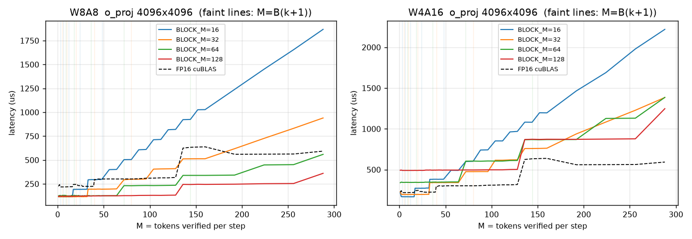

# specdec-quant-triton

Analysis of INT8/INT4 Triton GEMM and paged-attention kernels under the dynamic
shapes produced by speculative-decoding verification (draft length k = 2, 4, 8).

When a target model verifies `k` draft tokens for `B` sequences, the effective
token batch is `M = B·(k+1)`, which changes every step. This repo studies what that
does to quantized Triton kernels: tile utilization, register pressure, correctness
under dynamic shapes, and CUDA Graph padding waste (cf. PolyGraph,
[arXiv:2610.23861](https://arxiv.org/abs/2610.23861), which studies the graph side
for FP kernels but not quantized ones).

## Kernels (`kernels.py`)

| Kernel | Description |
|---|---|
| `w8a8_matmul` | INT8 activations × INT8 weights → INT32 accumulate on tensor cores; per-token activation scale, per-channel weight scale |
| `w4a16_matmul` | FP16 activations × packed INT4 weights (group size 128), dequantized in registers, FP16 tensor-core dot |
| `paged_attention` | Verification attention over an INT8 paged KV cache (per-token/per-head scales), causal over the k+1 query tokens, GQA-aware. `QPP` = queries per program: `1` = decode-style, `k+1` = fused verification |

Every kernel has a `USE_PLAN` mode: the active problem size is read from a small
GPU "plan" buffer and out-of-range programs exit early, so one CUDA graph captured
at the maximum grid serves every (B, k).

## Experiments

| Script | What it measures |
|---|---|
| `correctness.py` | Exhaustive M = 1..300 × every BLOCK_M vs exact reference; plan-mode never touches inactive rows; attention vs PyTorch reference; Triton recompilation count |
| `bench_matmul.py` | (A) latency staircase vs M per BLOCK_M; (B) B ∈ {1..32} × k ∈ {0,2,4,8} on Llama-3-8B linear shapes with config sweep |
| `regs.py` | registers/thread, spills, shared memory, theoretical occupancy per tile config |
| `bench_attention.py` | fused vs per-token INT8 paged attention across B, k = 0..8, context 1K/4K |
| `bench_graphs.py` | eager vs AllShapes vs MaxPad vs plan-buffer CUDA graphs on a 4-layer INT8 stack under a random (B, k) trace |
| `make_plots.py` | figures in `figures/` and tables in `results/summary.md` |

## Running

```bash
pip install -r requirements.txt   # on Windows use triton-windows
python correctness.py
python bench_matmul.py && python regs.py && python bench_attention.py && python bench_graphs.py
python make_plots.py
```

Hardware used: NVIDIA RTX 3050 6 GB Laptop GPU (Ampere, sm_86), PyTorch 2.11 + CUDA 12.8, Triton 3.5.

## Results

Full analysis with data: **[REPORT.md](REPORT.md)**. Headlines (RTX 3050 Laptop):

- **The cost unit is the M-tile, not the token.** Latency steps every BLOCK_M rows because each M-tile re-streams the weights (W8A8 o_proj: 116 µs at M ≤ 16 → 925 µs at M = 144 with BLOCK_M=16; flat to M = 128 with BLOCK_M=128).
- **INT8 verification is nearly free; INT4 is not.** At B=8, k=8, W8A8 costs 1.08× a decode step and W4A16 costs 3.12×, because dequant is redone per M-tile and register pressure (2.5× W8A8's) blocks larger tiles.
- **Fused paged attention** is 4.2× faster than per-token at k=8. With GQA group 4, k = 3 and 7 fill the tile exactly.
- **Plan-buffer CUDA graphs** (1 graph vs 48) are bit-exact. Padding cost tracks padded *tiles*: 58% token waste costs 33% with BLOCK_M=16 but only 6–10% with BLOCK_M=128.


