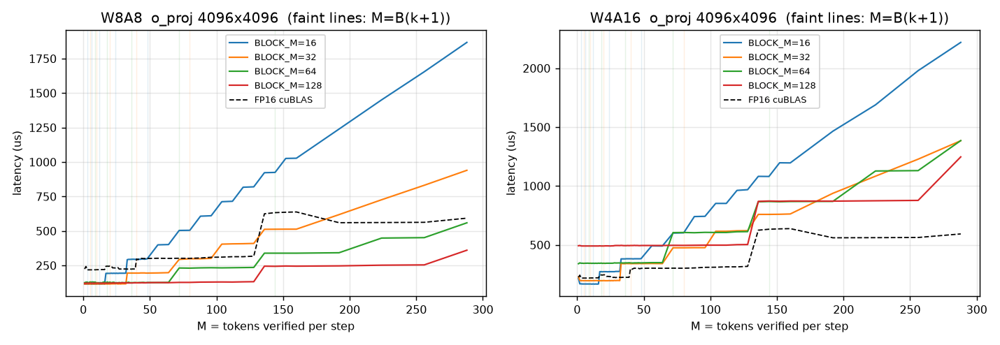
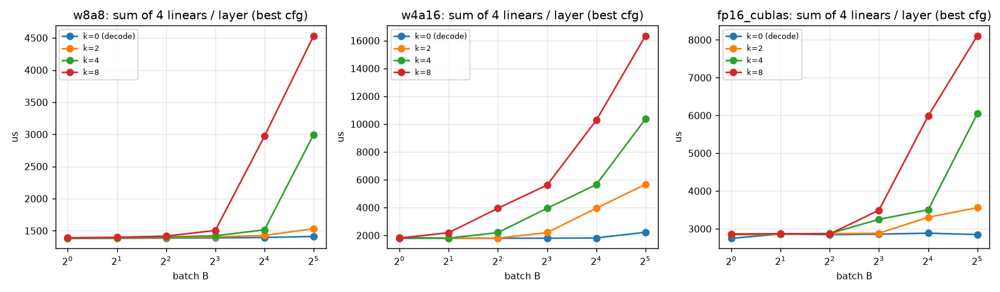
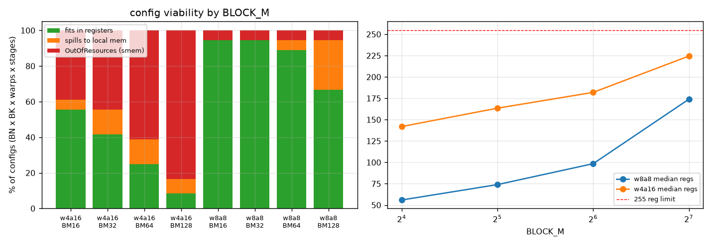
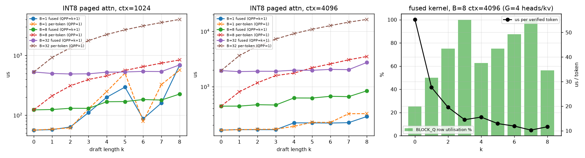
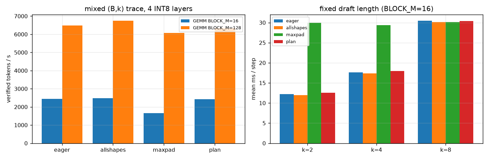

# INT8/INT4 Triton Kernels under Speculative-Decoding Verification Shapes

**Hardware:** NVIDIA RTX 3050 6 GB Laptop GPU (Ampere sm_86, 20 SMs), PyTorch 2.11 / CUDA 12.8, Triton 3.5.
**Model shapes:** Llama-3-8B (hidden 4096, QKV 6144, FFN 14336, 32 query heads / 8 KV heads, head dim 128).
**Sweep:** batch B ∈ {1, 2, 4, 8, 16, 32}, draft length k ∈ {2, 4, 8} (plus k = 0 decode baseline, and k = 0..8 for attention). Verification width is **M = B·(k+1)**.

All numbers are medians from `triton.testing.do_bench`. Raw data is in `results/*.json`, and every table is regenerated by `make_plots.py` into `results/summary.md`.

---

## TL;DR

1. **The cost unit is the M-tile, not the token.** `tl.dot` needs at least 16 rows, and each extra BLOCK_M rows re-streams the whole weight matrix. Latency is therefore a staircase in ⌈M/BLOCK_M⌉. With BLOCK_M=16, W8A8 o_proj grows from 116 µs (M ≤ 16) to 925 µs at M=144. With BLOCK_M=128 it stays at 120–132 µs all the way to M=128.
2. **INT8 keeps the free-verification property; INT4 loses it.** For W8A8, verifying k=8 drafts for B=8 sequences costs **1.08×** a plain decode step. For W4A16 (in-register dequant) the same step costs **3.12×**, because dequantization is redone for every M-tile. W4A16 is also slower than W8A8 at every (B, k) point measured here, even though it moves half the bytes: it reaches only about 50 GB/s against about 145 GB/s for INT8.
3. **Register pressure is what stops INT4 from using large tiles.** W4A16 needs 2.5× the registers of W8A8 at the same tile size (median 142 vs 56 at BLOCK_M=16, 224 vs 174 at 128). 57% of W4A16 configs fail with OutOfResources, versus 6% for W8A8. Large-M W4A16 configs spill.
4. **For paged attention, fusing the k+1 queries is essential, and some k are "free".** A per-token kernel re-reads the KV cache k+1 times (B=8, ctx 4096, k=8: 3.5 ms). The fused kernel reads it once (0.84 ms, 4.2× faster). The fused kernel's cost steps when (k+1)·G crosses 16 or 32 rows, so with GQA group G=4, **k=3 and k=7 fill the tile exactly**, while k=4 costs +34% over k=3.
5. **In quantized kernels, CUDA-Graph padding cost depends on padded tiles, not padded tokens.** With BLOCK_M=16, MaxPad to k=8 wastes 58% of tokens and loses 33% throughput (2.5× slower at fixed k=2). With BLOCK_M=128 the same 58% token waste costs only 6–10% on the mixed trace. A single plan-buffer graph (the PolyGraph mechanism) matched eager outputs **bit-exactly** (max |diff| = 0.0) and stayed within 2–9% of one-graph-per-shape while using 1 graph instead of 48. Switching the GEMM tile from 16 to 128 raised end-to-end throughput **2.6×**, more than any graph strategy did.

---

## 1. Kernels

| Kernel | Design |
|---|---|
| `w8a8_matmul` | INT8 × INT8 → INT32 `tl.dot` (tensor cores), per-token activation and per-channel weight scales applied in the epilogue |
| `w4a16_matmul` | FP16 activations × packed INT4 weights (two nibbles per byte, split K-halves so any BLOCK_K works), group-128 FP16 scales, dequant in registers, FP16 `tl.dot` |
| `paged_attention` | INT8 K/V pages (16 tokens per page, shuffled page table), per-token/per-head scales folded *after* QKᵀ and into P (scales commute out of the dot), online softmax, causal mask over the k+1 verification tokens. All G=4 query heads of a KV head are packed into the M dimension. `QPP` = queries per program (1 = decode-style, k+1 = fused). |
| `USE_PLAN` variant (all three) | Active extent (M, or B and q_len) is read from a 32-byte GPU plan buffer, and out-of-range programs return immediately, so one graph at max grid serves every shape |

## 2. Correctness under dynamic shapes (`correctness.py`)

| Check | Result |
|---|---|
| W8A8, **every** M = 1..300 × BLOCK_M ∈ {16, 32, 64, 128}, N=1000, K=520 (non-multiples of tiles) vs exact integer reference | max rel err 4.8e-4 (fp16 output rounding) |
| W4A16, M = 1..64 plus edge cases up to 300, all tile sizes, vs dequantized reference | max rel err 3.3e-4 |
| Paged attention, B ∈ {1, 3, 8}, k ∈ {2, 4, 8}, random context lengths (not page-aligned), QPP ∈ {1, k+1} | max abs err 9.8e-4 |
| Plan-mode GEMM: fixed grid at M_max=288, active M varied | rows ≥ M **never written** ✔ |
| Plan-mode attention: inactive sequences and query slots | **never written** ✔ |
| Plan-graph vs eager, every (B, k), full 4-layer stack | **max \|diff\| = 0.0** |
| Quantization error vs FP16 (random Gaussian weights) | W8A8 1.0%, W4A16-g128 11.7% |

**Finding: dynamic M causes JIT recompilation.** Over M = 1..300, Triton compiled **3 binaries per tile config** (12 for 4 configs). It specializes integer arguments on `== 1` and `% 16 == 0`, so the first step that lands in a new class stalls on compilation. That matters for serving latency, and it is a hazard for CUDA-Graph capture: compilation must happen before capture. The plan variant reads M from memory, never specializes, and always produces one binary. `do_not_specialize=["M"]` would also avoid this.

Other correctness notes:
- In plan mode, output rows ≥ M hold **stale** data. Consumers must respect the plan extent.
- The INT32 accumulator is safe for K < 2³¹/127² ≈ 133k.

## 3. Tile utilization: the staircase (`bench_matmul.py` Part A)



| o_proj 4096×4096, µs | M=1 | M=9 (B1,k8) | M=16 | M=17 | M=45 (B5,k8) | M=72 (B8,k8) | M=144 (B16,k8) |
|---|---|---|---|---|---|---|---|
| W8A8 BLOCK_M=16 | 116 | 116 | 115 | **193** | 298 | 504 | 925 |
| W8A8 BLOCK_M=64 | 125 | 129 | 129 | 125 | 127 | 231 | 339 |
| W8A8 BLOCK_M=128 | 120 | 122 | 121 | 122 | 124 | 127 | 244 |
| W4A16 BLOCK_M=16 | 215 | 168 | 168 | **272** | 382 | 600 | 1081 |
| W4A16 BLOCK_M=128 | 493 | 490 | 490 | 492 | 495 | 496 | 872 |
| FP16 cuBLAS | 224 | 218 | 220 | 244 | 300 | 302 | 633 |

- **Why it's a staircase:** each program computes a BLOCK_M × BLOCK_N tile and streams a K × BLOCK_N slab of weights. Total weight traffic is therefore ⌈M/BLOCK_M⌉ · |W|. In the decode regime the kernel is weight-bandwidth bound, so every new M-tile costs about one full weight read. M=17 costs 1.67× M=16.
- **Bandwidth check (M=1):** W8A8 reads 16.8 MB in 116 µs (**145 GB/s**) and cuBLAS FP16 reads 33.5 MB in 224 µs (**150 GB/s**). Both sit at the achievable DRAM bandwidth, so INT8 gives the expected ~1.9×. W4A16 reads 8.4 MB in 168 µs, only **50 GB/s**. It is bound by dequant ALU work, not memory, so INT4's 2× byte saving over INT8 never materializes.
- **Utilization of spec-decode shapes** (row utilization = M / (⌈M/BM⌉·BM)): for k=2, B=1 (M=3) uses 19% of a 16-row tile and 2% of a 128-row tile. Low utilization is harmless for W8A8 (compute is idle anyway), but expensive for W4A16, whose dequant work scales with tile count. Full table in `results/summary.md`.

## 4. Batch × draft length on a full layer (`bench_matmul.py` Part B)



Sum of the 4 linears of one Llama-3-8B layer, best config per shape:

| t(B,k) / t(B,0) | W8A8 k=2 | k=4 | k=8 | W4A16 k=2 | k=4 | k=8 | FP16 k=2 | k=4 | k=8 |
|---|---|---|---|---|---|---|---|---|---|
| B=1 | 1.00 | 1.00 | 1.01 | 1.04 | 1.04 | 1.01 | 1.04 | 1.04 | 1.04 |
| B=4 | 1.01 | 1.01 | 1.02 | 1.00 | **1.23** | **2.20** | 1.01 | 1.01 | 1.01 |
| B=8 | 1.01 | 1.02 | 1.08 | **1.22** | **2.20** | **3.12** | 1.01 | 1.14 | 1.22 |
| B=16 | 1.02 | 1.09 | 2.13 | 2.18 | 3.11 | 5.66 | 1.15 | 1.21 | 2.08 |
| B=32 | 1.09 | 2.12 | 3.21 | 2.55 | 4.66 | 7.34 | 1.25 | 2.12 | 2.85 |

- **W8A8** verifies up to M ≈ 128 tokens for almost the price of decoding one (1.38 ms vs 1.41–1.51 ms per layer). Speculation is nearly free here, so a larger k is affordable.
- **W4A16** leaves the flat region at M > 16. At B=8, k=8 costs 3.1× a decode step, which eats most of the gain from accepted tokens. **The optimal draft length depends on the quantization format.** An adaptive-k policy should use a cost model that includes the kernel's tile staircase, not just acceptance rate.
- **The oracle tile config changes with M:** BLOCK_M = 16 for M ≤ 16, 32 for ≤ 32, 64 for ≤ 64, 128 above (W8A8 gate_up). Running a fixed BLOCK_M=16 config across the k-sweep is up to **5.4× slower** than the oracle. A single compiled config, or a cache keyed on exact M, is a poor fit for dynamic k. An M-bucketed config dispatch with buckets aligned to 16/32/64/128 is the natural fix.

## 5. Register pressure (`regs.py`)



Swept BLOCK_M × BLOCK_N ∈ {64, 128, 256} × BLOCK_K ∈ {64, 128} × warps ∈ {4, 8} × stages ∈ {2, 3, 4} (144 configs per kernel) at M = 72 (B=8, k=8). Registers and spills come from Triton's compiled kernel; occupancy is computed from sm_86 limits.

| | W8A8 regs (median) | W4A16 regs (median) | W8A8 configs failing | W4A16 configs failing |
|---|---|---|---|---|
| BLOCK_M=16 | 56 | 142 | 2 / 36 | 14 / 36 |
| BLOCK_M=32 | 74 | 164 | 2 / 36 | 16 / 36 |
| BLOCK_M=64 | 99 | 182 | 2 / 36 | 22 / 36 |
| BLOCK_M=128 | 174 | 225 | 2 / 36 | 30 / 36 |

(Failures are `OutOfResources`: shared memory exceeds 100 KB/SM.)

- **Why INT4 costs registers:** unpacking two nibble planes, two scale tiles, two dequantized FP16 weight tiles and two activation tiles (one per K-half) are all live at once. W4A16 pipelines also need more shared memory per stage, which causes most of the failures (82/144 vs 8/144 for W8A8).
- **The INT4 tension:** a large BLOCK_M would amortize dequant across more rows (fixing finding 2), but at BLOCK_M=128 W4A16 hits the 255-register cap, spills, and drops to 8% theoretical occupancy. Small tiles keep registers in check but redo dequant for every 16 rows. Neither end is good, which is why W4A16 is slow for verification shapes.
- **Spills are catastrophic:** W8A8 128×256×128 with 4 warps reported 1,354 spills (Triton `n_spills`) and ran more than 10× slower than the best config.
- **Low occupancy is fine for W8A8:** the fastest W8A8 config (128×128×128, 8 warps, 4 stages, 176 regs) runs at 17% theoretical occupancy (one CTA per SM). Tile reuse and pipelining matter more than occupancy here.
- **Attention:** fused-kernel registers grow with BLOCK_Q: about 96 at 16 rows, 128 at 32 rows, 204 at 64 rows (k=8), with spills at BLOCK_N=128. This compounds the k=8 tile overflow in section 6.
- *Caveat:* the per-config timings inside `regs.py` use short runs and are noisy on this laptop (WDDM driver). Use them only for regs/spills/occupancy; timing conclusions come from the dedicated benchmarks.

## 6. Paged attention (`bench_attention.py`)



INT8 KV, ctx = 4096, µs:

| B | k=0 | fused k=2 | k=3 | k=4 | k=7 | k=8 | per-token k=2 | k=4 | k=8 |
|---|---|---|---|---|---|---|---|---|---|
| 1 | 163 | 166 | 166 | 220 | 222 | 287 | 168 | 190 | 324 |
| 8 | 442 | 470 | **464** | 623 | **657** | 838 | 1176 | 1759 | 3513 |
| 32 | 1947 | 1895 | **1893** | 1979 | **2027** | 2735 | 5439 | 9114 | 16490 |

- **Per-token kernel (QPP=1):** cost grows linearly in k+1, since each query token re-streams the full KV cache. **Fused (QPP=k+1):** KV is read once, and B=8, k=8 is 4.2× faster.
- **Fused-kernel staircase:** rows per program = (k+1)·G, padded to a power of 2 ≥ 16. With G=4 that gives 12/16 rows at k=2, **16/16 at k=3**, 20/32 at k=4, **32/32 at k=7** and 36/64 at k=8. Latency follows the tile, not k: at B=8, k=3 costs the same as k=2, k=4 jumps 34%, and k=8 jumps another 28%. So **k ∈ {3, 7} are the efficient draft lengths for G=4**; in general choose (k+1)·G = 16 or 32.
- **Bandwidth:** fused attention reaches about 140–154 GB/s at B ≥ 8 for k ≤ 3 (the same ceiling as the GEMMs), dropping to 80–100 GB/s at k=8, where BLOCK_Q=64 needs about 204 registers and occupancy falls.
- *Caveat:* B=1 at ctx=1024 runs for under 100 µs and is noisy (WDDM). Larger shapes are stable.

## 7. CUDA Graph strategies with quantized kernels (`bench_graphs.py`)



Four Llama-3-8B layers (W8A8 QKV / O / gate_up / down plus INT8 paged attention, ctx 1024), driven by 300-step traces with B ~ U[1, 16] and k ~ {2, 4, 8}, 3 seeds. Strategies follow PolyGraph: **eager**; **allshapes** (one graph per (B,k), 48 graphs); **maxpad** (one graph per B, always k=8, 16 graphs); **plan** (one graph at max grid plus a GPU plan buffer).

| GEMM tile | strategy | #graphs | P50 ms | P99 ms | token waste | tokens/s |
|---|---|---|---|---|---|---|
| BLOCK_M=16 | eager | – | 16.8 | 50.4 | 0% | 2449 |
| | allshapes | 48 | 16.6 | 50.2 | 0% | 2480 |
| | maxpad | 16 | 29.1 | 50.3 | 59% | **1652 (−33%)** |
| | plan | **1** | 17.1 | 50.5 | 0% | 2425 |
| BLOCK_M=128 | eager | – | 7.1 | 13.8 | 0% | 6491 |
| | allshapes | 48 | 6.8 | 13.6 | 0% | 6740 |
| | maxpad | 16 | 7.2 | 13.8 | 58% | **6074 (−10%)** |
| | plan | **1** | 7.2 | 13.8 | 0% | 6331 |

Fixed-k traces, mean ms per step (plan vs maxpad):

| | k=2 | k=4 | k=8 |
|---|---|---|---|
| BLOCK_M=16 | 12.6 vs 30.0 (**−58%**) | 18.0 vs 29.3 (−39%) | 30.4 vs 30.1 (+1%) |
| BLOCK_M=128 | 7.1 vs 7.9 (−10%) | 7.2 vs 8.0 (−10%) | 8.2 vs 8.0 (+3%) |

- **The plan-buffer graph works with quantized Triton kernels:** 1 graph instead of 48, bit-identical to eager, 2–6% below all-shapes on the mixed trace (up to 9% at fixed k=2). The overhead is the early-exit CTAs plus the 32-byte host→device plan copy, which matters more as steps get shorter.
- **Token waste is a misleading metric for quantized GEMMs.** The same 58% token waste costs 33% throughput with 16-row tiles and only 6–10% with 128-row tiles, because padded rows that fall inside an already-launched M-tile are almost free. **Cost should be measured in padded M-tiles**, ⌈M_pad/BM⌉ − ⌈M/BM⌉, which is what the kernel actually pays.
- **Tile choice matters more than graph strategy here:** BLOCK_M=128 is 2.6–3.7× faster than 16 across all strategies. Graphs only save about 1–4% over eager on this GPU, because each step is 7–17 ms of GPU work and kernel launch overhead (20 launches per layer) is comparatively small. On a datacenter GPU with shorter steps, launch overhead, and therefore graphs, would matter more.
- **The plan graph freezes one tile config for all M.** For W8A8 that is fine: BLOCK_M=128 costs only +4% at M=1 (120 vs 116 µs). For W4A16 it is not: BLOCK_M=128 is 2.9× slower than 16 at small M (490 vs 168 µs). Quantized INT4 kernels therefore need **multiple plan graphs bucketed by M**, each with its own tile config (PolyGraph's K > 1 buckets), whereas INT8 can live with one.
- P99 is dominated by the largest shape in the trace (B=16, k=8, M=144, which crosses the 128-row tile), not by graph mechanics.

## 8. Recommendations

1. **Dispatch the tile config by M-bucket** (16 / 32 / 64 / 128) instead of using one config or exact-M autotuning, and pre-compile every bucket before graph capture. Pass `do_not_specialize` for M, or read M from a plan buffer, to stop recompilation as M varies.
2. **Make adaptive-k policies tile-aware.** Prefer k with (k+1)·G = 16 or 32 for attention, and B·(k+1) just under a BLOCK_M multiple for GEMMs. Charge INT4 models a much steeper verification cost.
3. **For INT4, reduce live registers before growing tiles:** dequantize in smaller K sub-tiles, or use W4A8 with INT8 tensor cores so dequant becomes a scale in the epilogue. That would let INT4 use BLOCK_M ≥ 64 without spilling and recover the free-verification region INT8 already has.
4. **Fuse verification attention** across the k+1 tokens and the GQA group; never use one program per query token for verification.
5. **Pair plan-buffer graphs with M-buckets for INT4** (one graph per tile bucket), and report padding waste in tiles rather than tokens.

## 9. Limitations

- A single consumer laptop GPU (20 SMs, ~150 GB/s, WDDM driver). Absolute numbers and crossover points will differ on A100/H100, where tensor-core throughput is far higher relative to bandwidth, launch overhead is a bigger fraction, and the BLOCK_M crossover points will shift.
- Synthetic Gaussian weights, so the quantization-error numbers are not model-quality measurements. No draft model or acceptance-rate modeling.
- The graph experiment covers 4 layers with static activation buffers. Activation-quantization, norm and RoPE kernels are omitted.
- My kernels are reasonable but not hand-tuned to the level of production libraries (Marlin, FlashInfer, etc.). W4A16 in particular could be faster with better dequant layouts.

## Reproduce

```bash
pip install -r requirements.txt          # Windows: triton-windows
python correctness.py
python bench_matmul.py && python regs.py && python bench_attention.py
python bench_graphs.py                   # BLOCK_M=16
BLOCK_M=128 python bench_graphs.py       # BLOCK_M=128 variant
python make_plots.py
```
